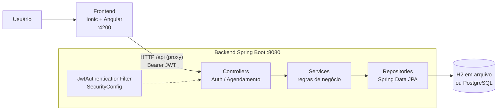
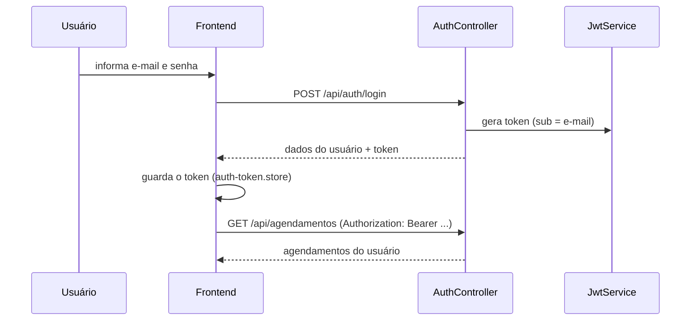
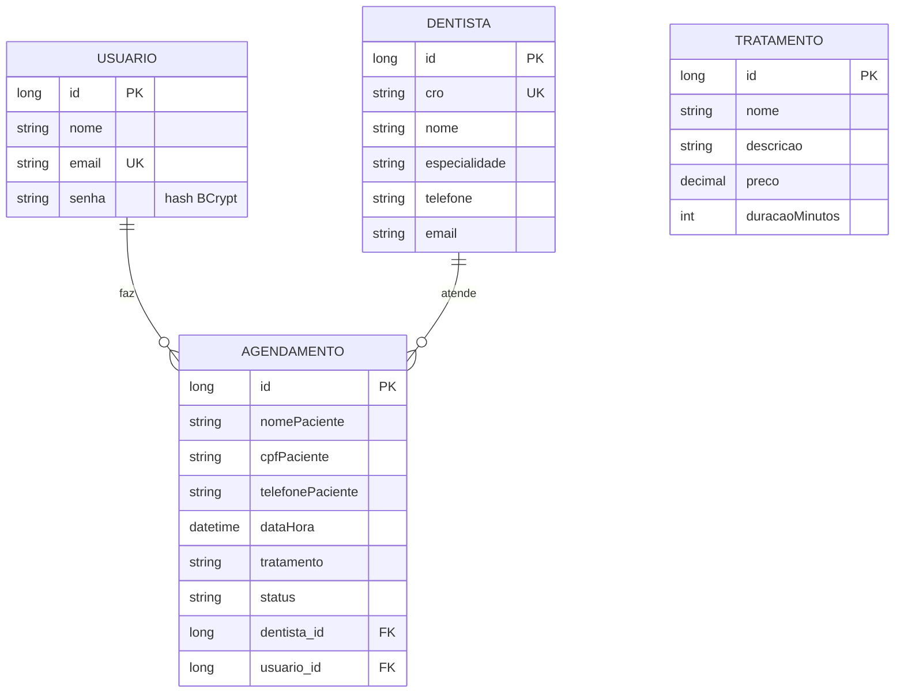

# Arquitetura do OdontoCare

> Responsável: Gaby Rodrigues
> Última atualização: 23/11/2026

## 1. Visão geral

O OdontoCare é um sistema web para uma clínica odontológica. O usuário cria uma conta, consulta os dentistas por especialidade e agenda consultas. O projeto é dividido em duas aplicações independentes que se comunicam por uma API REST:

- **backend**: API em Java com Spring Boot (porta 8080)
- **frontend**: aplicação Ionic com Angular (porta 4200)

**Objetivos do sistema**
- Permitir cadastro e login seguros de usuários.
- Mostrar os dentistas e as especialidades da clínica.
- Agendar consultas respeitando o horário de funcionamento e evitando conflitos.

## 2. Requisitos principais

### Funcionais
| ID | Requisito | Situação |
|----|-----------|----------|
| RF01 | Cadastro de usuário (nome, e-mail, senha) | Implementado |
| RF02 | Login com e-mail e senha, retornando token JWT | Implementado |
| RF03 | Consultar dados do usuário logado (`/api/auth/me`) | Implementado |
| RF04 | Criar agendamento com dados do paciente, tratamento, data/hora e dentista | Implementado |
| RF05 | Listar e consultar apenas os próprios agendamentos | Implementado |
| RF06 | Consultar horários ocupados de um dia (por dentista ou geral) | Implementado |
| RF07 | Listar dentistas por especialidade, com busca | Implementado no front, com dados de demonstração |
| RF08 | Ver detalhes de um dentista (rota protegida) | Implementado no front |
| RF09 | Lembretes/notificações no front | Implementado no front |

### Regras de negócio do agendamento
- A data e a hora devem ser futuras.
- Horários de **30 em 30 minutos**.
- Funcionamento: **08:00 às 12:00** e **14:00 às 18:00** (último início às 17:30).
- Um horário já ocupado (status diferente de `CANCELADO`) retorna erro 409. Se houver dentista, o conflito é checado por dentista.
- Todo agendamento novo nasce com status `PENDENTE`.

### Não funcionais
- **Segurança:** senhas com BCrypt, autenticação JWT sem sessão (stateless), rotas protegidas, CORS restrito a origens conhecidas.
- **Validação:** Bean Validation nos DTOs (CPF com 11 dígitos, e-mail válido, senha forte).
- **Privacidade:** cada usuário só enxerga os próprios agendamentos.
- **Responsividade:** menu lateral no computador e menu para celular.

## 3. Tecnologias utilizadas

| Camada | Tecnologia | Observação |
|--------|-----------|------------|
| Back-end | Java 25, Spring Boot 3.5.6 | Web, Data JPA, Validation, Security, Actuator |
| Autenticação | Spring Security + JJWT 0.11.5 | Token JWT assinado com HS256 |
| Banco de dados | H2 em arquivo (desenvolvimento) / PostgreSQL (driver incluído) | Troca por variáveis de ambiente |
| Build do back | Maven | `backend/pom.xml` |
| Front-end | Angular 22 + Ionic 9, TypeScript | Componentes standalone com *lazy loading* |
| Testes do back | JUnit / Spring Boot Test (MockMvc) | Banco H2 em memória |
| Testes do front | Vitest (unitários) e Playwright (E2E) | |
| Qualidade | ESLint + Prettier | `npm run lint` |
| Versionamento | Git / GitHub | |

## 4. Arquitetura do sistema

O back-end segue uma **arquitetura em camadas** (Controller, Service, Repository, Model). O front-end usa páginas do Ionic e serviços Angular em `core/`.



### Fluxo de autenticação



No front, o `auth.interceptor` anexa o token às requisições e o `auth.guard` bloqueia as rotas privadas.

## 5. Estrutura de pastas

```
OdontoCare/
├── backend/
│   ├── pom.xml
│   └── src/
│       ├── main/java/com/clinicaodonto/api/
│       │   ├── ClinicaOdontoApiApplication.java
│       │   ├── config/        # SecurityConfig, JwtAuthenticationFilter, CustomAuthenticationEntryPoint
│       │   ├── controllers/   # AuthController, AgendamentoController
│       │   ├── dtos/          # objetos de entrada e saída da API
│       │   ├── exceptions/    # GlobalExceptionHandler, EmailDuplicadoException
│       │   ├── models/        # entidades JPA
│       │   ├── repositories/  # acesso a dados
│       │   └── services/      # regras de negócio, JwtService
│       ├── main/resources/application.properties
│       └── test/              # testes de integração
├── frontend/
│   ├── e2e/                   # testes Playwright
│   ├── proxy.conf.json        # redireciona /api para :8080
│   └── src/app/
│       ├── core/              # guards, interceptors, models, services
│       ├── home/
│       └── pages/             # agendamentos, cadastro, dentistas, detalhes, login, perfil, sobre
├── docs/                      # documentação (este arquivo)
├── .gitignore
└── LICENSE
```

## 6. Módulos e responsabilidades

| Módulo | Responsabilidade |
|--------|------------------|
| Autenticação (`AuthController`, `UsuarioService`, `JwtService`) | Registrar, autenticar, gerar e validar o token |
| Segurança (`SecurityConfig`, `JwtAuthenticationFilter`) | Liberar só `POST /api/auth/register` e `/login`; exigir token no resto |
| Agendamentos (`AgendamentoController`, `AgendamentoService`) | Criar, listar, consultar e checar disponibilidade |
| Tratamento de erros (`GlobalExceptionHandler`) | Padronizar respostas de erro em JSON |
| Front: `core/services` | Comunicação com a API, sessão e notificações |
| Front: `pages` | Telas do sistema |

## 7. Endpoints da API

| Método | Rota | Acesso | Descrição |
|--------|------|--------|-----------|
| POST | `/api/auth/register` | Público | Cria usuário (201) ou retorna 409 se o e-mail já existe |
| POST | `/api/auth/login` | Público | Autentica e retorna token |
| GET | `/api/auth/me` | Autenticado | Dados do usuário do token |
| GET | `/api/agendamentos` | Autenticado | Lista os agendamentos do usuário, ordenados por data |
| GET | `/api/agendamentos/{id}` | Autenticado | Obtém um agendamento do usuário (404 se não for dele) |
| GET | `/api/agendamentos/disponibilidade?data=AAAA-MM-DD&dentistaId=` | Autenticado | Lista horários ocupados do dia |
| POST | `/api/agendamentos` | Autenticado | Cria agendamento (201) |

**Formato de erro padrão:** `timestamp`, `status`, `error`, `message` e, em validações, o campo `errors`.

## 8. Modelo de dados



Tabelas: `tb_usuarios`, `dentistas`, `agendamentos`, `tratamentos`. `Tratamento` não tem relacionamento: no agendamento, o tratamento é guardado como texto. O schema é criado automaticamente (`ddl-auto=update`).

## 9. Configuração e execução

**Variáveis de ambiente do back-end**

| Variável | Uso | Padrão |
|----------|-----|--------|
| `JWT_SECRET` | Chave de assinatura do JWT (**obrigatória**) | nenhum |
| `JWT_EXPIRATION_MS` | Validade do token | 3600000 (1 hora) |
| `DB_URL`, `DB_DRIVER`, `DB_USERNAME`, `DB_PASSWORD` | Banco de dados | H2 em `./data/odontocare` |
| `H2_CONSOLE_ENABLED` | Console do H2 em `/h2-console` | false |

**Rodar localmente**

```bash
# Terminal 1: back-end
cd backend
export JWT_SECRET="uma-chave-longa-e-aleatoria"
mvn spring-boot:run

# Terminal 2: front-end
cd frontend
npm ci
npm start        # http://localhost:4200
```

## 10. Decisões de arquitetura

| Decisão | Motivo |
|---------|--------|
| API REST separada do front | Permite evoluir e testar cada parte de forma independente |
| JWT stateless | Dispensa sessão no servidor e facilita escalar |
| BCrypt para senhas | Nunca guarda a senha em texto puro |
| H2 em arquivo no desenvolvimento, PostgreSQL por variável | Facilita rodar sem instalar banco, mantendo a troca simples |
| DTOs separados das entidades | Evita expor campos internos (como a senha) |
| `.gitignore` ignora `backend/data/` | Evita versionar contas e hashes de senha |
| Rotas do front com *lazy loading* e `authGuard` | Carregamento mais leve e páginas privadas protegidas |

## 11. Segurança e privacidade

- CPF, nome e telefone do paciente são dados pessoais (LGPD). Hoje ficam em texto simples no banco.
- O `GlobalExceptionHandler` não expõe detalhes internos em erros inesperados (retorna "Erro interno").
- CSRF está desabilitado, o que é adequado para API stateless com token no cabeçalho.
- O CORS aceita apenas `localhost:4200`, `8100` e `3000`. Em produção será preciso incluir o domínio real.

## 12. Limitações e melhorias futuras

Pontos observados no código atual:

- **Dentistas ainda não vêm da API:** `DentistasService` lê `assets/data/dentistas-demo.json`. A entidade e o repositório existem no back-end, mas falta um `DentistaController`.
- **Tratamentos sem endpoint:** existe o modelo, mas não há controller; o agendamento usa texto livre.
- **Logout:** o front trata o logout localmente; o back-end não tem rota de logout, e o token continua válido até expirar.
- **Status do agendamento** é um texto (`PENDENTE`, `CANCELADO`); um `enum` seria mais seguro.
- Não há rotas para **cancelar ou remarcar** agendamentos.
- Não há **pipeline de CI** para rodar os testes a cada Pull Request.
- A pasta `docs/` e o README da raiz ainda não existiam.
