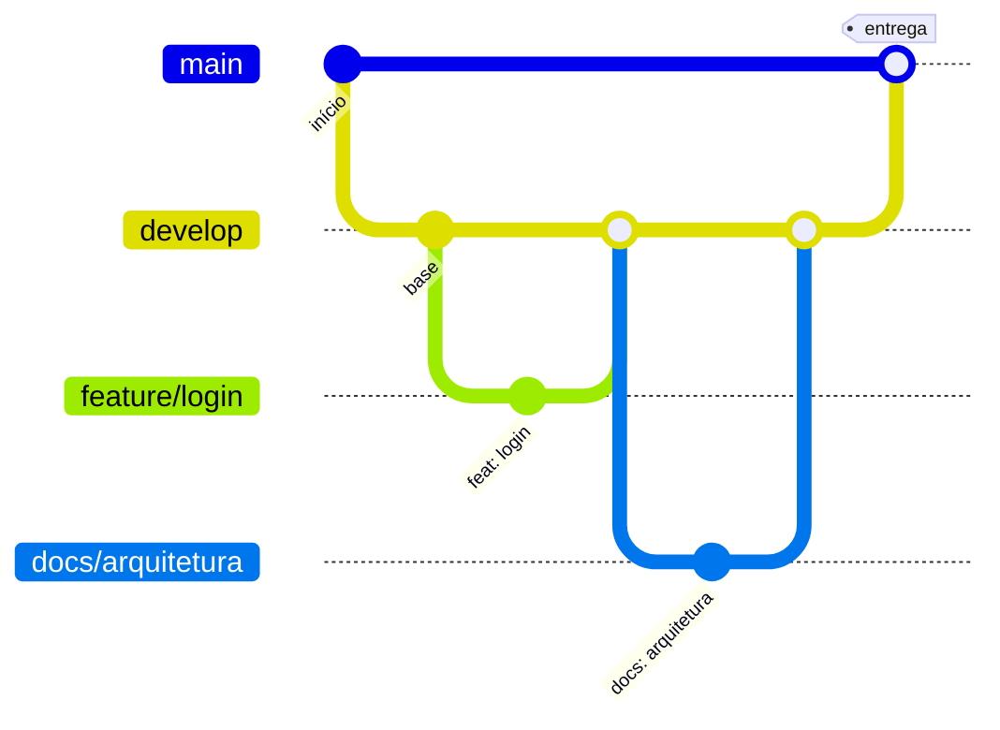

# Git Workflow do OdontoCare

> Responsável: Gaby Rodrigues
> Última atualização: 23/11/2026

Este documento define como o grupo usa Git e GitHub no OdontoCare, para evitar conflitos e manter o histórico organizado.

> O repositório tem a branch `develop`, usada como base de integração. Este fluxo parte dessa estrutura. Itens marcados com **(combinar)** precisam ser confirmados pelo grupo.

## 1. Branches

| Branch | Função | Regras |
|--------|--------|--------|
| `main` | Versão estável, pronta para entrega | Nunca receber commit direto. Só recebe merge de `develop` via Pull Request |
| `develop` | Integração das funcionalidades | Recebe merge das branches de trabalho via Pull Request |
| `feature/<nome>` | Nova funcionalidade | Criada a partir de `develop` |
| `fix/<nome>` | Correção de bug | Criada a partir de `develop` |
| `docs/<nome>` | Documentação | Criada a partir de `develop` |
| `test/<nome>` | Testes | Criada a partir de `develop` |

**Padrão de nomes:** minúsculas, palavras separadas por hífen.
Exemplos: `feature/cadastro-agendamento`, `fix/horario-ocupado`, `docs/arquitetura`.



## 2. Passo a passo do dia a dia

```bash
# 1. Atualizar a develop local
git checkout develop
git pull origin develop

# 2. Criar a branch da tarefa
git checkout -b feature/nome-da-tarefa

# 3. Trabalhar e fazer commits pequenos
git add <arquivos>
git commit -m "feat: descrição curta do que foi feito"

# 4. Enviar a branch
git push -u origin feature/nome-da-tarefa

# 5. Abrir Pull Request para develop no GitHub
```

Prefira `git add <arquivos>` a `git add .`, para não incluir arquivos indesejados.

## 3. Padrão de commits

Formato: `tipo: descrição curta no imperativo`

| Tipo | Uso | Exemplo |
|------|-----|---------|
| `feat` | Nova funcionalidade | `feat: adiciona validação de horário no agendamento` |
| `fix` | Correção de bug | `fix: corrige conflito de horário por dentista` |
| `docs` | Documentação | `docs: adiciona plano de testes` |
| `style` | Formatação, sem mudar lógica | `style: formata arquivos com prettier` |
| `refactor` | Reestruturação de código | `refactor: extrai validação de horário` |
| `test` | Testes | `test: cobre login com credenciais inválidas` |
| `chore` | Tarefas gerais | `chore: atualiza .gitignore` |

Dica: indique a área quando ajudar, por exemplo `feat(backend): ...` ou `fix(frontend): ...`.

## 4. Pull Requests

1. O PR vai **para `develop`** (só a entrega final vai de `develop` para `main`).
2. Título claro, seguindo o padrão de commits.
3. Na descrição, informe: o que foi feito, por que e como testar.
4. Marque pelo menos **1 revisor** do grupo **(combinar)**.
5. Só faça merge após aprovação e sem conflitos.
6. Depois do merge, apague a branch.

**Checklist do PR**
- [ ] Back-end: `mvn test` passa (rodando em `backend/`)
- [ ] Front-end: `npm run lint` e `npm run test:unit` passam (rodando em `frontend/`)
- [ ] A documentação foi atualizada, se necessário
- [ ] Nenhum segredo foi incluído (`JWT_SECRET`, senhas, arquivo `.env`)
- [ ] Nenhum arquivo local foi incluído (`backend/data/`, `*.mv.db`, `target/`, `node_modules/`)

## 5. Revisão de código

- O revisor responde em até **24 horas** **(combinar)**.
- Comentários devem ser objetivos e respeitosos.
- Quem abriu o PR resolve os comentários antes do merge.
- Mudanças de segurança (autenticação, JWT, CORS) pedem atenção redobrada na revisão.

## 6. Resolvendo conflitos

```bash
git checkout feature/minha-branch
git pull origin develop
# resolva os conflitos nos arquivos marcados, depois:
git add <arquivos-resolvidos>
git commit -m "chore: resolve conflitos com develop"
git push origin feature/minha-branch
```

Em caso de dúvida, avise o grupo antes de agir. **Nunca use `git push --force` em `main` ou `develop`.**

## 7. Boas práticas

- Faça `git pull` antes de começar a trabalhar.
- Commits pequenos e frequentes, com uma mudança lógica cada.
- Uma branch por tarefa.
- Nunca suba senhas, tokens ou dados reais de pacientes. O `JWT_SECRET` fica em variável de ambiente ou no `.env` local.
- Não versione o banco local. O `.gitignore` já ignora `backend/data/`, `*.mv.db` e `backend/target/`.
- Mantenha o `.gitignore` atualizado.

## 8. Releases e entrega

1. Confirme que `develop` está estável (testes passando).
2. Abra PR de `develop` para `main`.
3. Após o merge, crie uma tag com a versão: `git tag v1.0.0 && git push origin v1.0.0`.

## 9. Responsáveis

| Área | Responsável |
|------|-------------|
| Revisão de PRs | **(combinar)** |
| Merge em `develop` e `main` | **(combinar)** |
| Documentação | Gaby Rodrigues |
